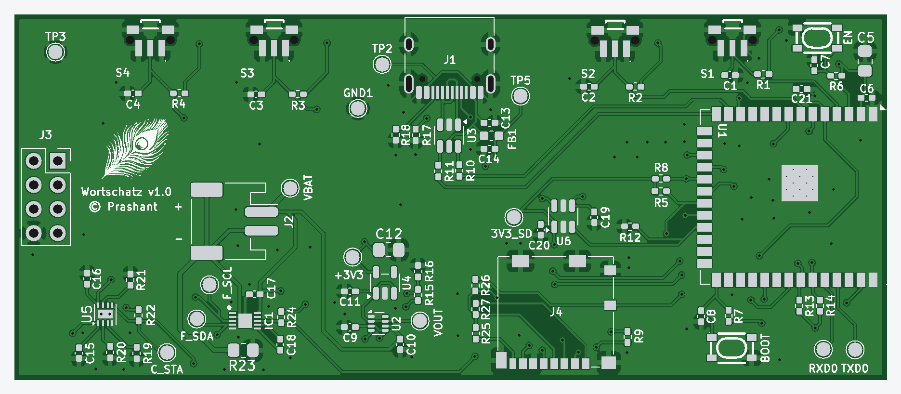

# Wortschatz – E-Ink German Vocabulary Device

Battery-powered e-ink device that shows random German words with their grammar. Built around an ESP32-S3, designed in KiCad 10, 4-layer PCB made by JLCPCB, hand-assembled.

## Specs

| | |
|---|---|
| **MCU** | ESP32-S3-WROOM-1-N16R8 (16 MB flash, 8 MB PSRAM, Wi-Fi/BLE, native USB) |
| **Display** | WeAct 2.9" e-paper, 296 × 128, SSD1680, SPI |
| **Storage** | microSD (Molex 104031-0811), SPI, card detect |
| **Battery** | 820 mAh Li-Po, JST PH, built-in protection |
| **Charging** | TI BQ25170 linear charger, 400 mA, 4.2 V |
| **Fuel gauge** | Maxim MAX17055 (ModelGauge m5), 10 mΩ sense resistor |
| **Power path** | TI TPS2116 power mux (USB priority) → RT9080 3.3 V LDO |
| **SD power** | TI TPS22929D load switch |
| **USB** | USB-C (5.1 kΩ CC pull-downs), USBLC6-2 ESD protection |
| **Inputs** | 4 side buttons (wake from deep sleep), EN and BOOT buttons |
| **PCB** | 4 layers, 92.0 × 38.5 mm, 1.6 mm, mostly 0402 parts |

## Design decisions

**Power path (TPS2116):** switches between USB and battery automatically, with no diode voltage drop. A 220k/100k divider on PR1 gives USB priority, and the battery takes over the moment USB is unplugged.

**Charging (BQ25170):** a simple linear Li-ion charger set by three resistors.
- `ISET = 750 Ω` → 300 / 750 = **400 mA**, about 0.5C for the 820 mAh cell, so a full charge takes about 2–2.5 h
- `VSET = 27 kΩ` → **4.2 V** charge voltage
- The `STAT` output goes to a GPIO to show a charging indicator

**Battery percentage (MAX17055):** a real fuel gauge instead of guessing from battery voltage. It measures current through a 10 mΩ resistor in the battery's negative lead and reports over I²C, with an alert pin for low battery.

**Low power:**
- The ESP32 sleeps between button presses. All 4 buttons are on RTC GPIOs, so any press wakes it (ext1 wake-up).
- The e-paper keeps its image without power.
- The SD card's supply is fully switched off by a TPS22929 load switch, with a pull-down so it stays off during sleep. The SD pull-ups sit on the switched rail, so nothing leaks into the unpowered card.

**PCB:** 4-layer stackup with signals / solid GND / split power planes / signals. The ESP32 antenna overhangs the board edge with a copper keep-out, there are GND stitching vias, thermal vias under the charger's exposed pad, and test points on every power rail, I²C and UART0.

## Pin map

| Function | GPIO |
|---|---|
| Buttons 1–4 | IO4, IO6, IO7, IO1 |
| SPI MOSI / SCK (shared) | IO11 / IO12 |
| E-paper CS / DC / RST / BUSY | IO10 / IO8 / IO9 / IO14 |
| SD CS / MISO | IO15 / IO13 |
| SD power enable / card detect | IO21 / IO5 (0 = card inserted) |
| Fuel gauge SDA / SCL / ALERT | IO41 / IO42 / IO40 |
| Charger status | IO38 |
| USB D− / D+ | IO19 / IO20 |
| UART0 TX / RX (test pads) | IO43 / IO44 |
| BOOT | IO0 |

## Files

| File | Description |
|---|---|
| `hardware/kicad/` | KiCad 10 project (schematic + PCB + custom libraries) |
| `hardware/Schematic.pdf` | Schematic, viewable without KiCad |
| `hardware/BOM.csv` | Bill of materials with LCSC part numbers |
| `hardware/Gerber.zip` | Gerber and drill files for manufacturing |
| `docs/` | Project overview PDF and images |

## Ordering the PCB

1. Upload `hardware/Gerber.zip` to [JLCPCB](https://jlcpcb.com).
2. Select **4 layers, 1.6 mm**. Set the minimum via hole size to **0.2 mm** (the ESP32 footprint's GND pad has 0.2 mm vias).
3. Order the parts from [LCSC](https://lcsc.com) using `BOM.csv`.

## Status

| | |
|---|---|
| ✅ Power rails (5 V, 3.3 V) | Working |
| ✅ USB ↔ battery switchover | Working |
| ✅ SD card (read, card detect) | Working |
| ✅ Flashing via UART0 test pads | Working |
| 🔧 Native USB | Not enumerating yet, under investigation |
| 🔧 Firmware (e-paper UI, word database, fuel gauge, deep sleep) | In progress |

## License

MIT
